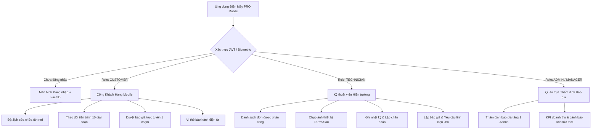

# Tài liệu Kiến trúc Ứng dụng Di động — Điện Máy PRO (Mobile App Architecture)

Tài liệu này đặc tả toàn bộ kiến trúc kỹ thuật, luồng dữ liệu, phân quyền và kế hoạch triển khai của ứng dụng di động **Điện Máy PRO** dành cho Hệ thống Quản lý Sửa chữa Điện máy — Điện lạnh.

---

## 1. Tổng quan & Mục tiêu

- **Tên ứng dụng**: Điện Máy PRO
- **Nền tảng**: iOS & Android (Single Codebase)
- **Công nghệ cốt lõi**: **React Native 0.88 + Expo SDK 58 (TypeScript)**
- **Kiến trúc mô hình**: **All-in-One Role-based App** (Một ứng dụng duy nhất dùng chung cho Khách hàng, Kỹ thuật viên hiện trường và Quản trị viên; tự động chuyển giao diện theo vai trò sau khi xác thực).
- **Backend tích hợp**: Node.js / Express REST API hiện tại (Cổng 3000, 31 bảng MySQL).



---

## 2. Công nghệ & Thư viện sử dụng

| Hạng mục | Thư viện / Công cụ | Mục đích |
| :--- | :--- | :--- |
| **Framework** | Expo SDK 58 / React Native 0.88 | Nền tảng phát triển ứng dụng di động đa nền tảng |
| **Ngôn ngữ** | TypeScript (Strict mode) | Đảm bảo tính an toàn kiểu dữ liệu 100% |
| **Navigation** | `@react-navigation/native-stack`, `@react-navigation/bottom-tabs` | Điều hướng màn hình native hiệu năng cao |
| **Lưu trữ an toàn** | `expo-secure-store` | Lưu JWT token và cấu hình nhạy cảm vào iOS Keychain / Android Keystore |
| **Sinh trắc học** | `expo-local-authentication` | Đăng nhập 1 chạm bằng Vân tay (Fingerprint) hoặc Face ID |
| **HTTP Client** | `axios` | Xử lý request, timeout, đính kèm Bearer token và interceptor tự động |
| **Camera & Ảnh** | `expo-camera`, `expo-image-picker` | Chụp và chọn ảnh hiện trạng máy phục vụ nhật ký kỹ thuật |
| **Thông báo đẩy** | `expo-notifications` / Firebase Cloud Messaging (FCM) | Nhận thông báo thời gian thực khi có báo giá cần duyệt, phân công đơn mới |

---

## 3. Cấu trúc Thư mục Mã nguồn (`mobile/`)

```
mobile/
├── app.json                       # Cấu hình Expo, Bundle ID, Android Permissions, Icons
├── App.tsx                        # Root component (SafeAreaProvider, AuthProvider, RootNavigator)
├── tsconfig.json                  # Cấu hình TypeScript compiler
├── package.json                   # Danh mục dependencies và scripts khởi chạy
└── src/
    ├── api/                       # Tầng giao tiếp REST API (tái sử dụng từ Web client)
    │   ├── client.ts              # Axios instance, interceptors, error formatters
    │   ├── auth.ts                # Login, Logout, GetMe, ChangePassword
    │   ├── repairs.ts             # Danh sách phiếu, chi tiết, chuyển trạng thái, duyệt báo giá
    │   ├── repair-logs.ts         # Nhật ký công việc, đính kèm ảnh trước/sau
    │   └── customer-portal.ts     # Đơn hàng khách, thẻ bảo hành, đặt lịch sửa
    ├── auth/                      # Quản lý phiên làm việc & Token bảo mật
    │   ├── AuthContext.tsx        # React Context quản lý user state, quyền hạn, đăng nhập/đăng xuất
    │   └── SecureTokenStore.ts    # Wrapper bọc expo-secure-store và expo-local-authentication
    ├── navigation/                # Hệ thống điều hướng phân tầng
    │   ├── RootNavigator.tsx      # Bộ điều hướng gốc: AuthStack <-> Role-based AppStack
    │   ├── TechnicianTabs.tsx     # Bottom Tabs dành riêng cho Kỹ thuật viên
    │   ├── CustomerTabs.tsx       # Bottom Tabs dành riêng cho Khách hàng
    │   └── AdminStack.tsx         # Stack Navigator dành cho Quản trị viên
    ├── screens/                   # Các màn hình chức năng theo vai trò
    │   ├── auth/
    │   │   └── LoginScreen.tsx    # Đăng nhập form, ẩn/hiện pass, ghi nhớ user, FaceID/Vân tay
    │   ├── technician/
    │   │   ├── WorkOrderListScreen.tsx    # Danh sách đơn KTV được giao, bộ lọc tìm kiếm
    │   │   ├── WorkOrderDetailScreen.tsx  # Chi tiết đơn, chẩn đoán, gọi điện, chỉ đường
    │   │   └── CameraLogScreen.tsx        # Chụp ảnh đối chiếu Trước/Sau sửa chữa
    │   ├── customer/
    │   │   ├── CustomerOrderListScreen.tsx # Lịch sử đơn của khách
    │   │   ├── OrderTrackingScreen.tsx    # Tiến trình 10 giai đoạn, duyệt báo giá 1 chạm
    │   │   └── WarrantyScreen.tsx         # Ví lưu trữ thẻ bảo hành điện tử còn/hết hạn
    │   ├── admin/
    │   │   ├── AdminDashboardScreen.tsx   # Thống kê nhanh, báo giá chờ Admin duyệt
    │   │   └── QuoteApprovalScreen.tsx    # Giao diện thẩm định báo giá tầng 1 (Duyệt/Yêu cầu sửa)
    │   └── common/
    │       └── ProfileScreen.tsx          # Xem hồ sơ cá nhân, đổi mật khẩu, đăng xuất
    ├── components/                # UI components dùng chung
    │   ├── StatusBadge.tsx        # Huy hiệu trạng thái chuẩn hóa màu sắc theo 10 giai đoạn
    │   └── EmptyState.tsx         # Giao diện trạng thái trống
    └── utils/                     # Tiện ích định dạng
        ├── formatCurrency.ts      # Định dạng tiền tệ VNĐ chuẩn (Intl.NumberFormat)
        ├── formatDate.ts          # Định dạng ngày giờ chuẩn người dùng Việt Nam
        └── repairStatus.ts        # Bảng tra cứu 10 trạng thái phiếu sửa chữa
```

---

## 4. Cơ chế Xác thực & Điều hướng Tự động

### 4.1. Luồng Xác thực (Authentication Flow)
1. **Lần đầu mở ứng dụng**:
   - `AuthContext` đọc `auth_token` từ `expo-secure-store`.
   - Nếu có token: Gửi request `GET /api/v1/auth/me` để lấy thông tin `user`, `roles`, `permissions`, `primaryRole`.
   - Nếu token hợp lệ: Chuyển thẳng vào giao diện tương ứng theo `primaryRole`.
   - Nếu token không có hoặc hết hạn: Chuyển về `LoginScreen`.
2. **Đăng nhập form**:
   - Người dùng nhập username + password.
   - Gửi `POST /api/v1/auth/login`.
   - Lưu JWT token vào `SecureStore`.
   - Cập nhật `AuthContext.user` ➔ `RootNavigator` tự động re-render và chuyển vào App Stack mà không cần reload trang.
3. **Sinh trắc học (Face ID / Vân tay)**:
   - Nếu thiết bị có phần cứng (`LocalAuthentication.hasHardwareAsync()`) và đã kích hoạt sinh trắc học:
   - Cho phép mở khóa nhanh bằng vân tay/Face ID thay vì nhập lại mật khẩu.

### 4.2. Ma trận Điều hướng theo Vai trò (Role-based Routing)

| `primaryRole` | Stack / Tabs hiển thị | Quyền hạn & Chức năng chính |
| :--- | :--- | :--- |
| `CUSTOMER` | **CustomerTabs** | Đặt lịch, theo dõi tiến trình 10 giai đoạn, duyệt báo giá, xem bảo hành |
| `TECHNICIAN` | **TechnicianTabs** | Xem đơn được giao, chụp ảnh trước/sau, chẩn đoán, báo giá, yêu cầu linh kiện |
| `ADMIN`, `MANAGER` | **AdminStack** | Thẩm định báo giá (Tầng 1 Admin), xem KPI doanh thu, cảnh báo kho |
| `RECEPTIONIST`, `ACCOUNTANT`, `WAREHOUSE_STAFF` | **TechnicianTabs / AdminStack** | Xem thông tin tra cứu phiếu và lịch sử xử lý tại hiện trường |

---

## 5. Lộ trình Triển khai 4 Giai đoạn Chi tiết

### Giai đoạn 1: Nền tảng & Authentication ([TASK-M01](tasks/TASK-M01.md)) — ĐÃ HOÀN THÀNH
- [x] Scaffold dự án Expo TypeScript `mobile/`.
- [x] Cài đặt Navigation: `@react-navigation/native`, `@react-navigation/native-stack`, `@react-navigation/bottom-tabs`.
- [x] Tích hợp `expo-secure-store` và `expo-local-authentication`.
- [x] Xây dựng tầng API client với `axios`, tự động gắn Bearer token và xử lý lỗi 401.
- [x] Hoàn thiện `AuthContext` quản lý phiên và phân quyền 6 vai trò.
- [x] Hoàn thiện màn hình `LoginScreen` với UI chuyên nghiệp, hỗ trợ ẩn/hiện mật khẩu, ghi nhớ user và sinh trắc học.
- [x] Kiểm tra TypeScript: **0 lỗi (`tsc --noEmit` PASS 100%)**.

### Giai đoạn 2: App Kỹ thuật viên Hiện trường ([TASK-M02](tasks/TASK-M02-technician-field-app.md))
- [x] Màn hình Danh sách Đơn được giao (`WorkOrderListScreen`): Lọc theo trạng thái `ASSIGNED`, `DIAGNOSING`, `IN_PROGRESS`.
- [x] Màn hình Chi tiết Đơn (`WorkOrderDetailScreen`): Thông tin máy, địa chỉ khách, nút gọi điện thoại nhanh, nút mở bản đồ dẫn đường.
- [x] Chụp ảnh Hiện trạng (`CameraLogScreen`): Chụp 2-4 ảnh trước khi mở máy và sau khi sửa xong, lưu vào `repair_logs`.
- [x] Lập Chẩn đoán & Báo giá tại chỗ: Chọn linh kiện từ danh mục kho, nhập tiền công, gửi duyệt Admin.
- [x] Báo giá bổ sung: Hỗ trợ tạo báo giá phát sinh khi tháo máy phát hiện lỗi mới.

### Giai đoạn 3: Cổng Khách hàng & Push Notification FCM ([TASK-M03](tasks/TASK-M03-customer-portal-push-notification.md))
- [x] Màn hình Đặt lịch Sửa chữa (`CreateBookingScreen`): Chọn dòng thiết bị, mô tả lỗi, đính kèm ảnh chụp máy hỏng, chọn khung giờ hẹn.
- [x] Theo dõi Tiến trình 10 Giai đoạn (`OrderTrackingScreen`): Timeline trực quan theo thời gian thực kèm Modal từ chối báo giá (Android/iOS).
- [x] Duyệt Báo giá 1 chạm: Hiển thị bảng chi tiết linh kiện + tiền công đã được Admin duyệt; nút bấm "Đồng ý sửa" hoặc "Từ chối".
- [x] Ví Thẻ bảo hành điện tử (`WarrantyScreen`): Tra cứu mã thẻ, thời hạn bảo hành còn lại từ `GET /api/v1/customer/warranties`.
- [x] Hạ tầng Backend Push Notification: Bảng `user_device_tokens`, endpoint đăng ký token và module gửi thông báo tự động theo sự kiện workflow.

### Giai đoạn 4: Admin Thẩm định & Hoàn thiện E2E ([TASK-M04](tasks/TASK-M04-admin-approval-e2e-delivery.md))
- [x] Giao diện Thẩm định Báo giá Tầng 1 (`QuoteApprovalScreen`): Xem báo giá KTV vừa lập, phê duyệt hoặc yêu cầu chỉnh sửa kèm ghi chú.
- [x] Dashboard Điều hành (`AdminDashboardScreen`): Theo dõi các đơn chờ duyệt, KPI quản lý trên di động.
- [x] Kiểm thử E2E liên thông hệ thống: `verify-mobile-e2e.js` chạy 12 bước nghiệp vụ liên thông Web ↔ Mobile đạt 100%.
- [x] Đóng gói và phát hành: Cấu hình `eas.json` hoàn chỉnh (`development`, `preview` APK, `production` AAB).

---

## 6. Hướng dẫn Chạy Thử nghiệm (Development Guide)

### 6.1. Khởi chạy Backend
Backend đang chạy ở chế độ nền tại cổng 3000 (`http://192.168.1.101:3000`):
```bash
cd backend
npm run start
```

### 6.2. Khởi chạy Ứng dụng Mobile
Mở terminal tại thư mục `mobile`:
```bash
cd mobile
npx expo start -c
```
- **Chạy trên Điện thoại thật**: Mở ứng dụng **Expo Go** trên Android/iOS, quét mã QR hiển thị ở terminal (điện thoại và máy tính kết nối chung mạng Wi-Fi LAN `192.168.1.101`).
- Màn hình Đăng nhập đã có sẵn bộ nút **1-click điền nhanh tài khoản** cho KTV (`ktv_dung`), Admin (`admin`), Lễ tân (`letan_mai`), Thủ kho (`thukho_an`), Kế toán (`ketoan_hoa`) và ô cấu hình IP máy chủ linh hoạt.

### 6.3. Đóng gói file cài đặt APK (Android Standalone)
Để đóng gói file `.apk` cài đặt trực tiếp không cần qua Expo Go:
```bash
cd mobile
npx eas-cli build -p android --profile preview
```
